# 번개알림 사용설명서

카카오톡 단톡에서 **번개모임**이랑 **선착순 나눔**만 골라, 바로 알려 주는 앱입니다. 스토어에는 없고, 받은 파일로 설치합니다.

화면 맨 아래에는 탭이 세 개입니다.

- **홈**: 지금 잘 듣고 있는지, 골라 낸 글
- **규칙**: 어떤 단톡을 볼지
- **설정**: 얼마나 예민하게 볼지, 알람 시간, 연결

같은 내용을 앱에서도 볼 수 있습니다. 규칙이 없으면 홈의 **사용법**, 규칙을 만든 뒤에는 **설정 → 고지 → 사용법**입니다.

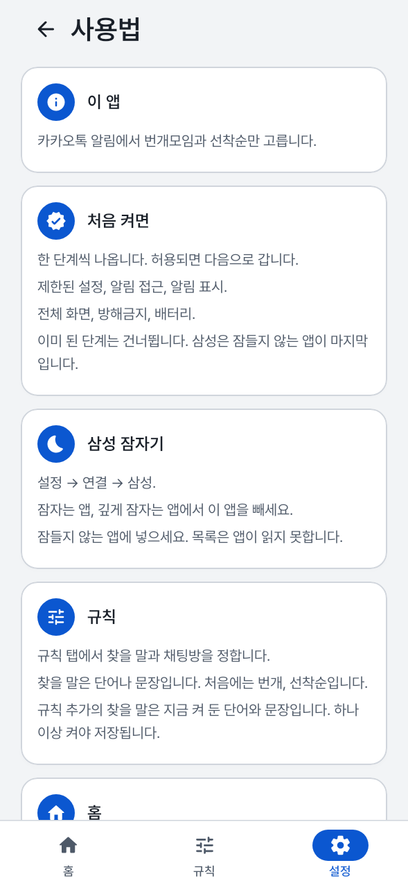

## 1. 파일 받아서 설치하기

받은 파일 이름은 보통 `app-debug.apk`입니다. 카카오톡이나 문자로 와도 되고, 파일을 휴대폰으로 옮겨도 됩니다.

1. 파일을 누릅니다.
2. 설치가 막히면, 방금 그 파일을 연 앱(카카오톡, 크롬, 내 파일 등)에서 **이 출처 허용**을 켭니다. 휴대폰 설정에서는 **애플리케이션 → 특별한 접근 → 알 수 없는 앱 설치** 근처에 있습니다.
3. 파일로 돌아와서 다시 설치합니다.
4. 예전에 받은 다른 파일로 깔아 둔 앱이 있으면 덮어쓰기가 안 됩니다. 그 앱을 지운 다음 다시 설치하세요. 지우면 알림 접근도 다시 켜야 합니다.

이미 이 앱이 깔려 있고 새 버전이 있으면, 설정 위의 **업데이트**만 누르면 됩니다. 앱이 파일을 받아 확인한 다음 설치 창을 엽니다. 설치 창에서 한 번 더 설치를 눌러 주세요. 알림이 오면 그 알림의 **업데이트**도 같습니다. 버튼을 누르기 전에는 설치하지 않습니다. 처음이거나 이 앱의 설치가 허용되어 있지 않으면, 허용 화면이 열립니다. 허용하고 돌아오면 이어서 받습니다.

## 2. 처음 실행

앱을 처음 열면 허용을 한 가지씩 묻습니다. 허용되면 다음으로 넘어갑니다. 이미 되어 있는 단계는 그냥 지나갑니다.

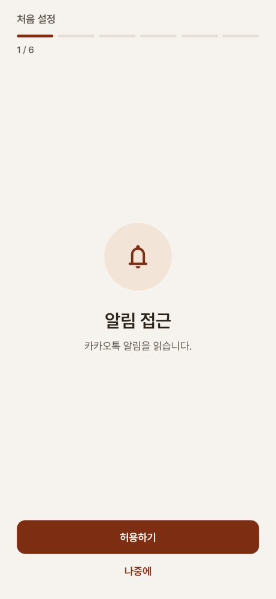

나오는 순서는 이렇습니다.

| 화면 | 버튼 | 하는 일 |
| --- | --- | --- |
| 제한된 설정 | 설정 열기 | 파일로 깐 앱은 알림 접근이 잠길 수 있습니다. 앱 정보 오른쪽 위 메뉴에서 제한된 설정을 허용한 뒤 돌아옵니다. |
| 알림 접근 | 허용하기 | 알림 접근 목록에서 **번개알림**을 켭니다. 카카오톡 알림을 읽으려면 꼭 필요합니다. |
| 알림 표시 | 허용하기 | 이 앱이 알림을 띄울 수 있게 합니다. |
| 전체 화면 | 허용하기 | 잠금 화면 위로 알람이 뜨게 합니다. 안드로이드 14 이상에서 필요합니다. |
| 방해금지 | 허용하기 | 방해금지 중에도 울리게 합니다. |
| 배터리 | 허용하기 | 배터리 최적화에서 이 앱을 제외합니다. |
| 잠들지 않는 앱 | 설정 열기 | 삼성 휴대폰에만 나옵니다. |

각 화면의 버튼을 누르면 휴대폰 설정이 열립니다. 허용하고 앱으로 돌아오면 다음 단계로 갑니다.

## 3. 삼성 갤럭시에서 잠자기 빼기

배터리 최적화만 꺼서는 부족합니다. 갤럭시는 앱을 따로 재웁니다.

앱에서 **설정 → 연결**로 갑니다. 삼성 휴대폰이면 **삼성**이 보입니다.

- **잠자는 앱**, **깊게 잠자는 앱**을 열어 번개알림을 뺍니다.
- **잠들지 않는 앱**에 넣습니다.

휴대폰 설정에서 직접 가려면 **설정 → 배터리 및 디바이스 케어 → 배터리 → 백그라운드 사용 제한**입니다. 사용하지 않는 앱 절전도 이 앱을 재울 수 있으니, 거기 있으면 빼 주세요.

이 목록에 들어 있는지는 앱이 읽지 못합니다. 넣어 둔 뒤에도 화면에 체크가 생기지 않습니다.

## 4. 규칙 만들기

규칙을 만들기 전에는 아무 방도 보지 않습니다. **규칙** 탭을 엽니다.

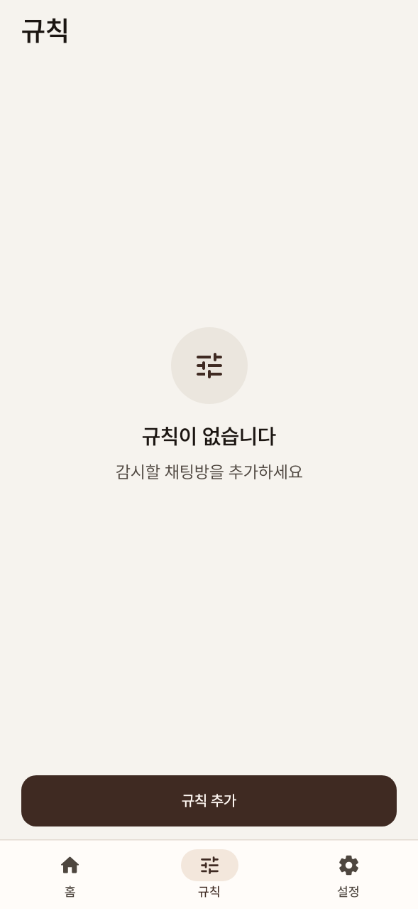

**규칙 추가**를 누릅니다.

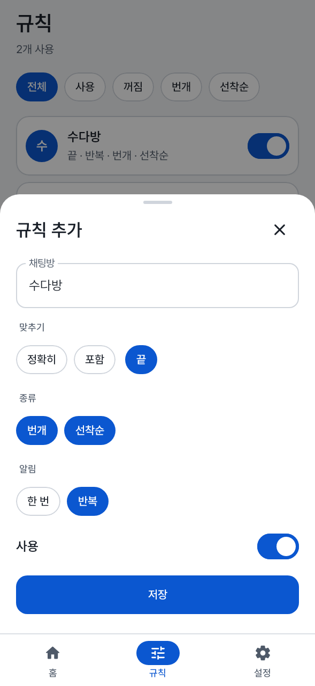

- **채팅방**: 단톡 이름을 적습니다. 달마다 바뀌면 끝만 적어도 됩니다. 예: `수다방`은 `10월의 수다방`에도 맞습니다. 이름이 늘 같으면 **정확히**를 고릅니다.
- **맞추기**: **끝**, **포함**, **정확히** 중 하나입니다.
- **종류**: **번개**, **선착순**. 볼 것만 켜세요. 둘 다 끄면 저장되지 않습니다.
- **알림**: **한 번**은 알림이 한 번 옵니다. **반복**은 아래 알람처럼 울립니다.
- **사용**: 끄면 그 규칙은 쉬고 있습니다.

저장한 뒤에는 목록에서 스위치를 눌러 켜고 끌 수 있습니다. 카드를 누르면 고칩니다. 지울 때는 수정 화면의 **삭제**입니다.

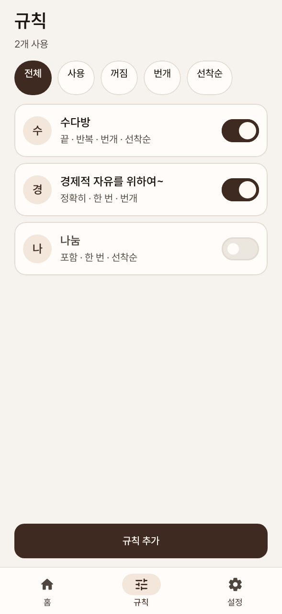

## 5. 홈 화면

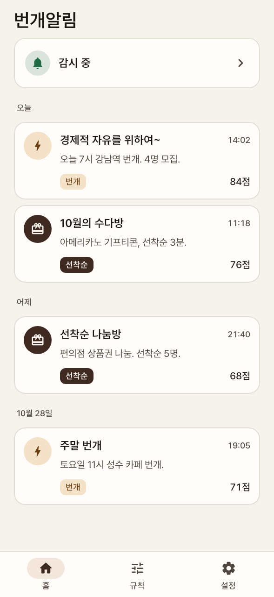

맨 위 배너가 상태입니다.

- **감시 중**: 카카오톡 알림을 듣고 있습니다. 누르면 연결 화면으로 갑니다.
- **알림을 받지 않는 중**: 알림 접근이 꺼져 있습니다. 배너를 누르면 그 설정이 열립니다.

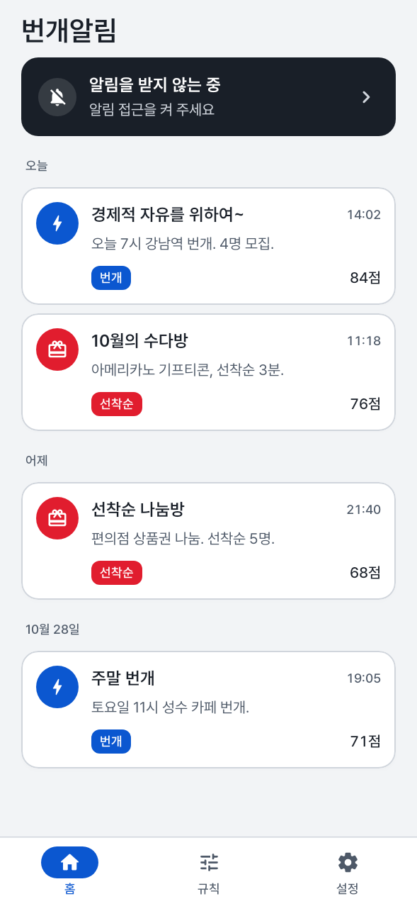

- **연결이 끊겼습니다**: 권한은 있는데 연결이 떨어졌습니다. 배너를 누르면 연결 화면으로 갑니다.

고른 글은 **오늘**, **어제**, 그다음엔 날짜로 모입니다. 카드에는 방 이름, **번개** 또는 **선착순** 칩, 글 한두 줄, 시간, 점수가 있습니다.

아직 글이 없으면 이렇게 보입니다.

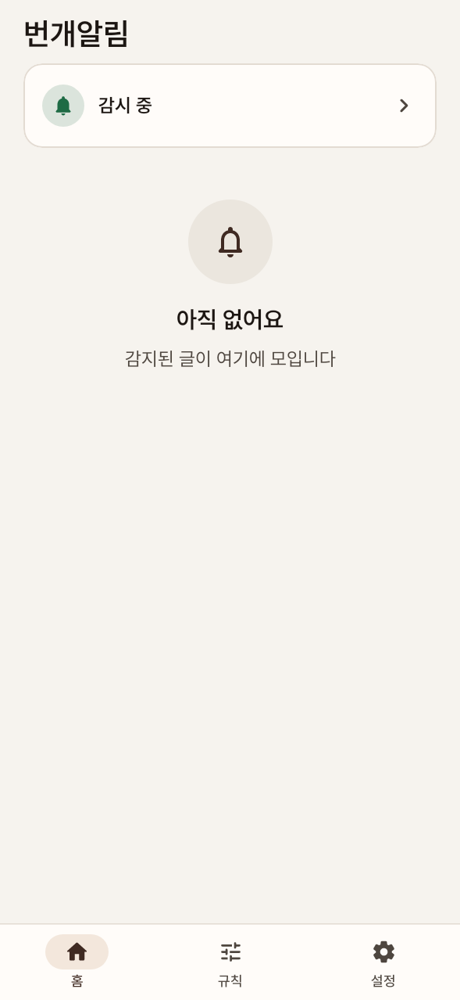

규칙이 하나도 없으면 배너 아래에 **사용법**이 보입니다. 거기를 눌러도 이 안내를 앱 안에서 볼 수 있습니다.

## 6. 알람

규칙에서 알림을 **반복**으로 두면, 확인할 때까지 소리와 진동이 반복됩니다. 처음 한도는 3분입니다. **설정 → 알림 → 반복 한도**에서 바꿉니다. **한 번**이면 알림만 한 번 오고 이 화면은 안 뜹니다.

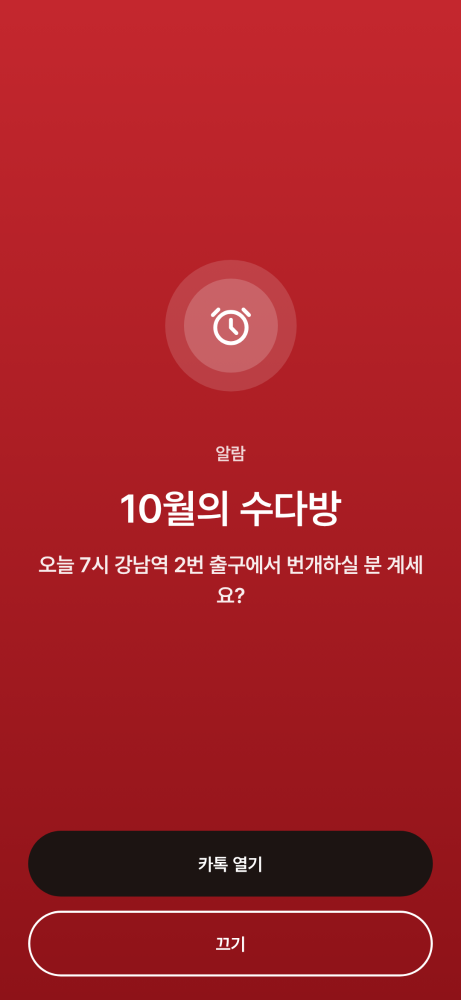

- **카톡 열기**: 그 카카오톡 방으로 가고, 알람은 꺼집니다. 원래 알림으로 그 방을 열 수 없으면 카카오톡 앱이 열립니다.
- **끄기**: 카카오톡은 열지 않고 알람만 멈춥니다.

한도가 지나도 알람은 스스로 멈춥니다.

## 7. 어떤 글을 알림으로 볼지

점수는 항상 이 폰 안에서 계산합니다. 네트워크가 없어도 점수는 나옵니다.

**설정 → 알림**에 **기준**이 있습니다. 처음 값은 62점이고, **이 점수부터 알림**이라고 적혀 있습니다. 슬라이더를 **엄격** 쪽으로 밀면 기준이 높아지고, **느슨** 쪽으로 밀면 낮아집니다.

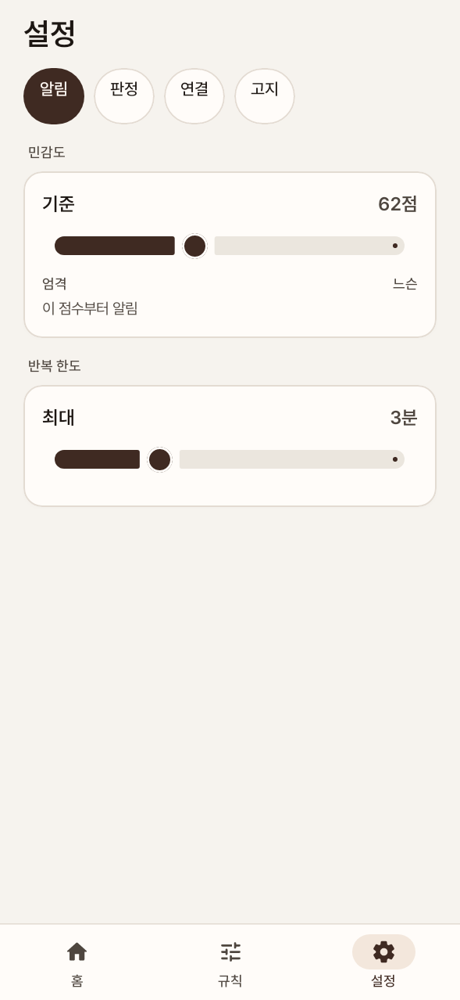

기준보다 훨씬 높은 글은 바로 알립니다. 훨씬 낮은 글은 알리지 않습니다. 그 사이, 애매한 글만 보조 판정에 물어봅니다. 보조 판정이 없거나 실패하면 다시 점수로 결정합니다. 설정 화면의 문구는 **실패하면 다음, 없으면 점수로 결정합니다**입니다.

**설정 → 판정**에서 보조 판정을 고릅니다.

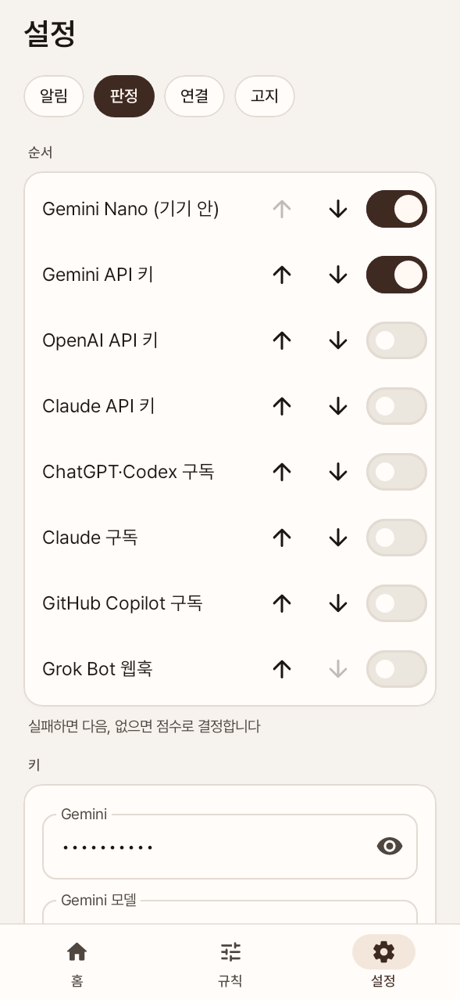

- **점수**: 따로 켤 필요가 없습니다. 항상 먼저 돌아갑니다.
- **Gemini Nano (기기 안)**: 처음부터 켜져 있습니다. 그 폰이 지원할 때만 쓰고, 지원하지 않으면 조용히 넘어갑니다. 글은 폰 밖으로 나가지 않습니다.
- **내 API 키**: **키**에 Gemini, OpenAI, Claude 키를 넣습니다. 위 목록에서 그 항목 스위치를 켜야 실제로 물어봅니다. 켠 서비스에만, 애매한 글만 갑니다.

같은 **판정** 화면에 **구독 로그인**과 **Grok Bot 웹훅**도 있습니다. 둘 다 처음부터 꺼져 있고, 직접 켜기 전에는 글을 보내지 않습니다. Grok은 답이 늦을 수 있습니다. 구독 로그인은 **고지**의 **위험 안내**에 동의한 뒤에만 버튼이 동작합니다.

점수가 궁금하면 **판정** 맨 아래 **문장 시험**에 글을 붙여 넣을 수 있습니다. 시험은 알림을 보내지 않습니다.

## 8. 알림이 안 올 때

하나씩만 보면 됩니다.

1. **홈** 배너를 봅니다. **알림을 받지 않는 중**이면 배너를 눌러 **알림 접근**에서 번개알림을 켭니다.
2. **연결이 끊겼습니다**이면 **설정 → 연결 → 다시 연결**을 누릅니다. **새로고침**은 화면의 표시만 다시 읽습니다.
3. 연결이 더 필요하면 **연결 자세히**를 엽니다. 알림 접근, 리스너, 마지막 카카오톡 시각이 있습니다. 리스너는 카카오톡 알림을 받고 있는 연결입니다.

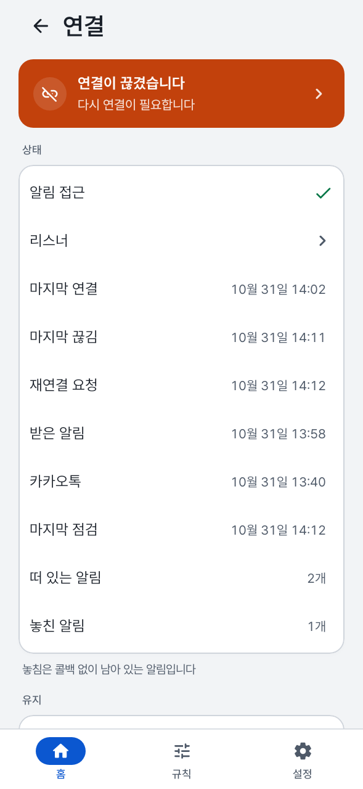

4. 카카오톡에서 그 단톡의 알림이 켜져 있는지 봅니다. 카카오톡이 알림을 아예 만들지 않으면 이 앱도 볼 수 없습니다.
5. **규칙**에서 그 방이 **사용** 중인지, 이름 맞추기(**끝**, **포함**, **정확히**)가 맞는지 봅니다. 종류에서 번개나 선착순이 켜져 있는지도 봅니다.
6. 삼성 휴대폰이면 위의 잠자기 목록을 다시 확인합니다. **설정 → 연결**의 **상태 알림**은 프로세스를 깨워 두려고 켠 것이고, 삼성 잠자기를 대신하지는 않습니다. 화면에 그렇게 적혀 있습니다.
7. 파일로 설치했다면 앱 정보의 **제한된 설정**이 풀려 있는지도 봅니다. **설정 → 연결 → 앱 정보**는 연결 자세히 안에 있습니다.

## 9. 개인정보

알림 내용과 채팅방 이름은 이 폰 안에만 저장합니다.

점수만 쓰거나 **Gemini Nano (기기 안)**만 쓰면, 글은 폰 밖으로 나가지 않습니다.

**API 키**, **구독 로그인**, **Grok Bot 웹훅**을 켠 경우에만, 기준 근처의 애매한 글이 그 서비스로 갑니다. 스위치를 끄면 그 서비스에는 보내지 않습니다. 키는 폰 안에 암호화해서 저장합니다.

## 화면을 모아 두면

밝은 화면과 어두운 화면은 같은 구성입니다.

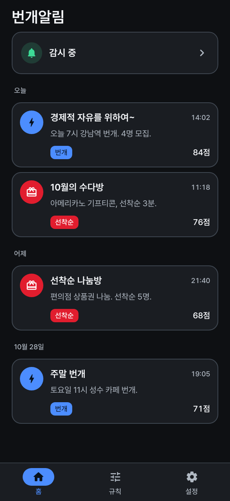
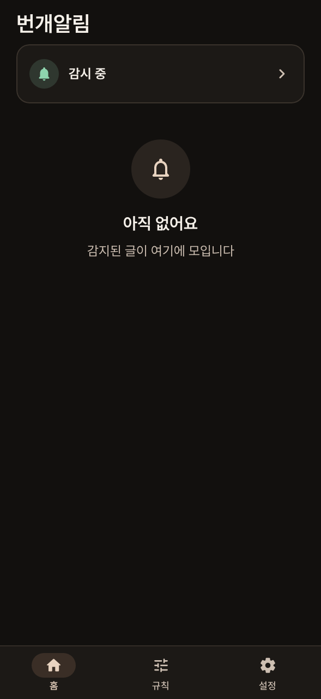
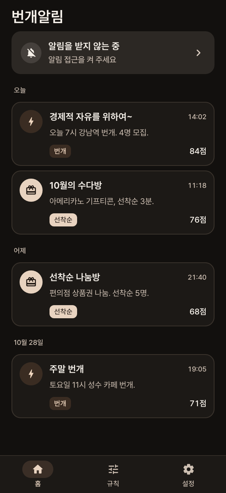
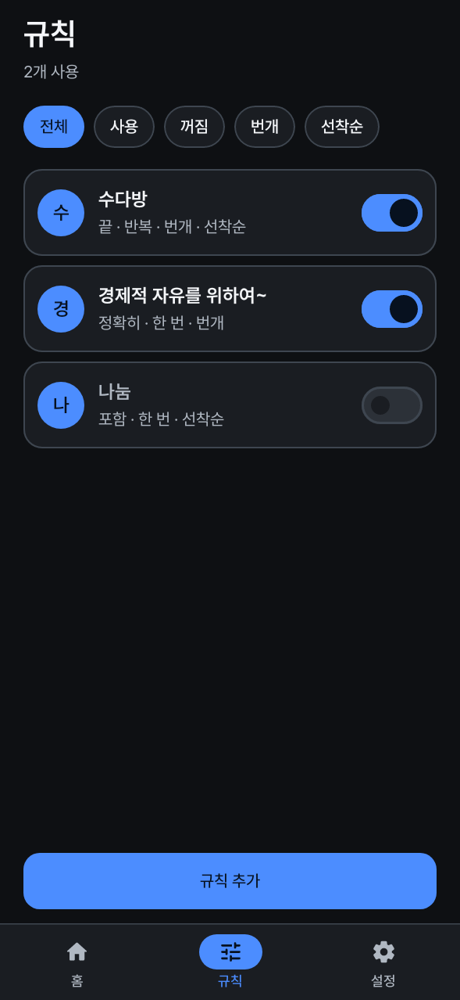
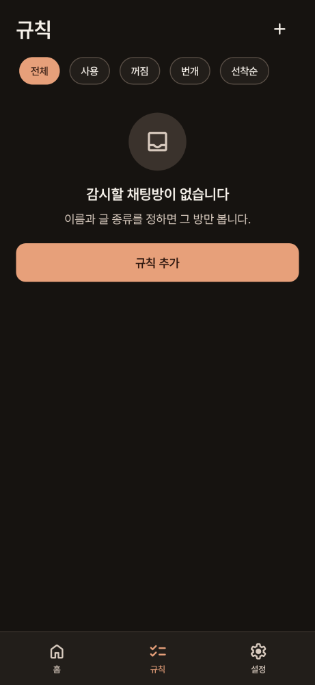
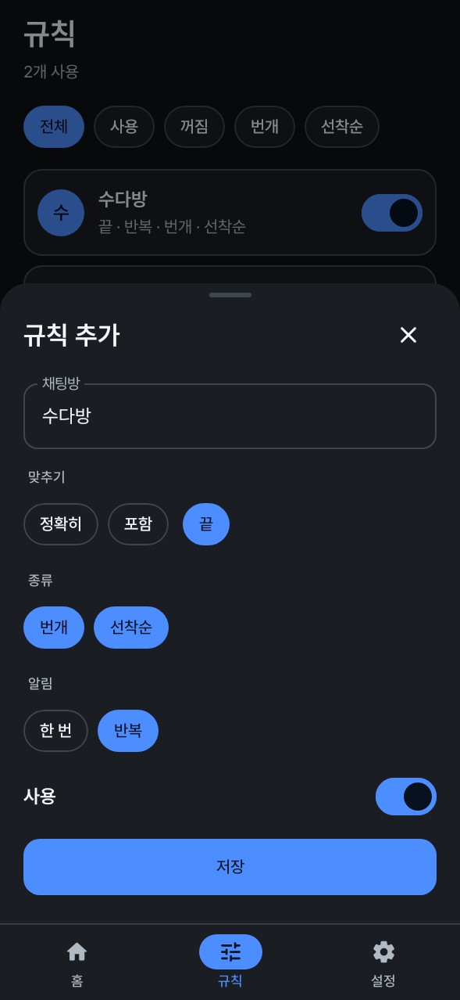
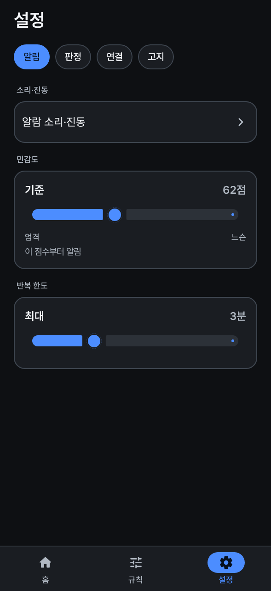
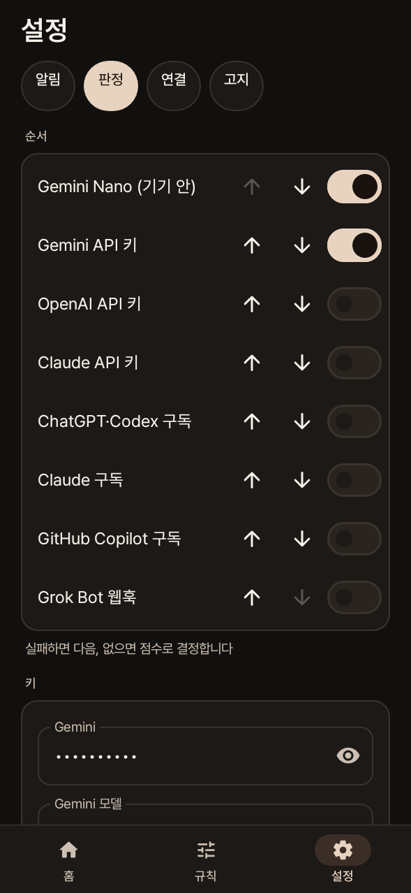
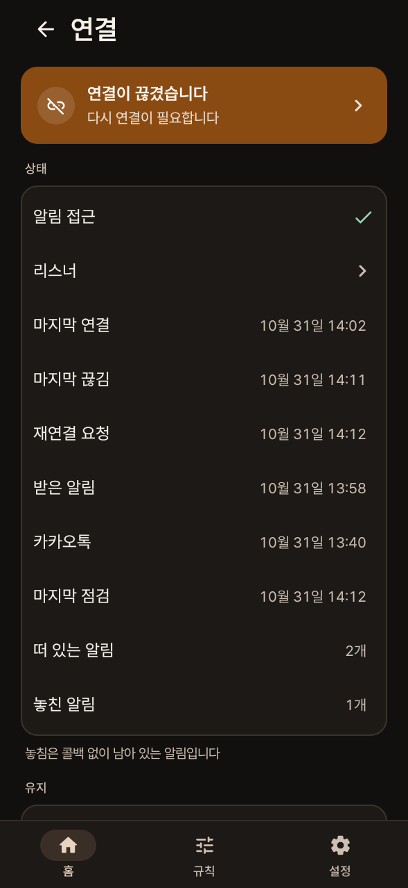
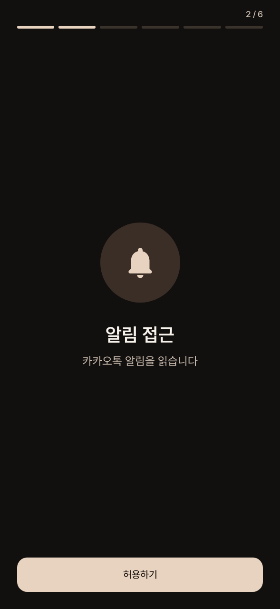
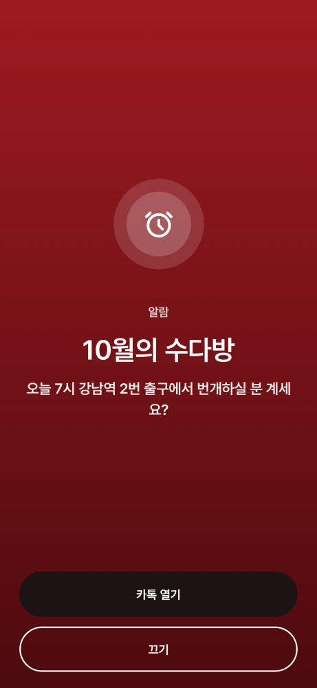
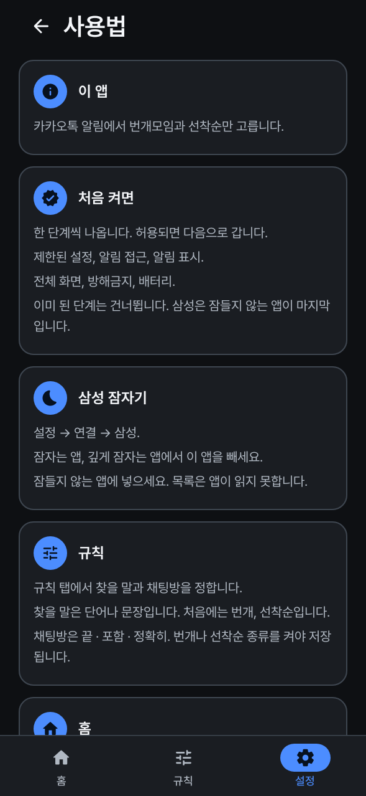

문장 시험에서 판정이 진행 중일 때와, 판정이 실패했을 때입니다.

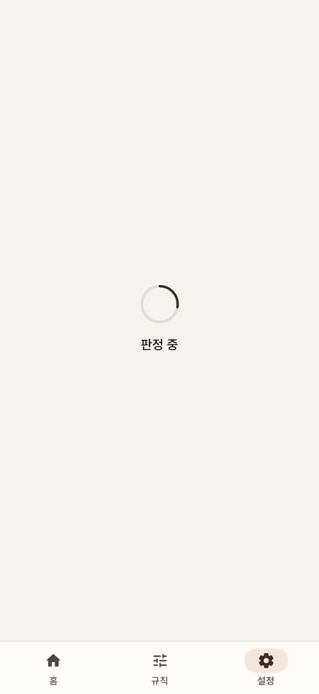
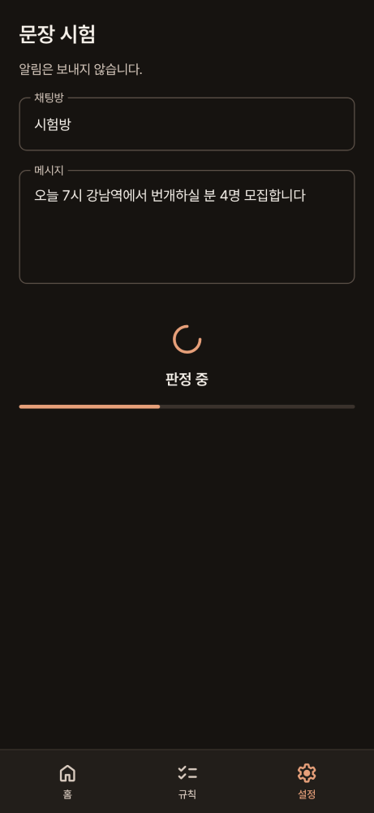
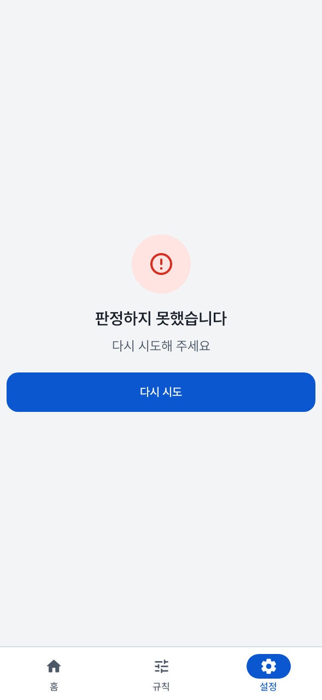
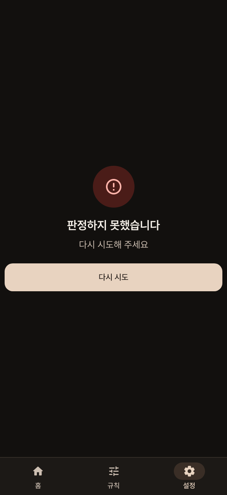
